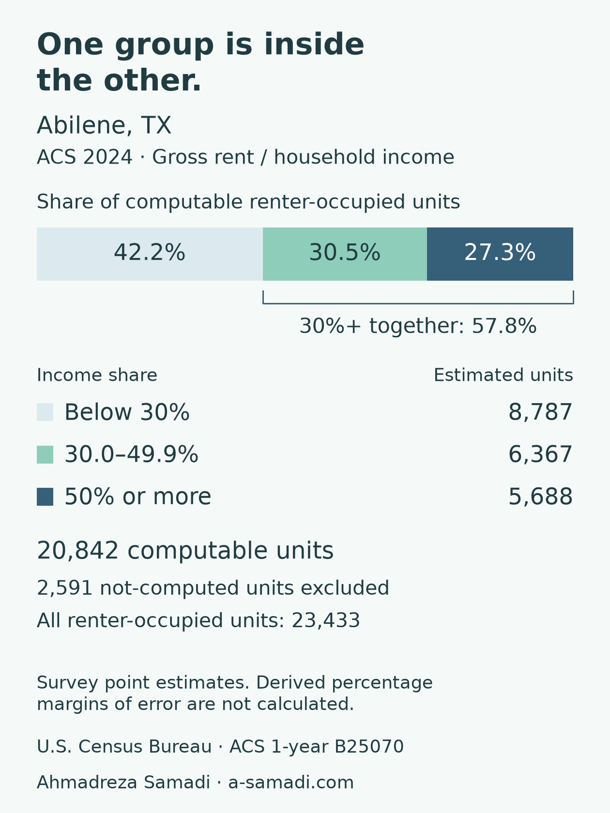

# Why the two rent-burden percentages must not be added

A reading illustration by [Ahmadreza Samadi](https://a-samadi.com/about.html), using the unchanged ACS 2024 snapshot in this repository. This adds an explanation, not a new study, survey year or investment ranking.



[Scalable SVG](nested-thresholds-2024.svg) · [Full text alternative](nested-thresholds-alt.txt) · [Values and source record](nested-thresholds-source.json)

## Read the groups before the thresholds

Abilene, TX Metro Area is selected because it has the lowest numeric CBSA code (10180) in the stored 386-metro CSV. It was not selected for a high or low rent-burden result.

The Census table has **23,433 estimated renter-occupied units**, including **2,591 not-computed units**. The percentage denominator here excludes those not-computed units: **20,842 computable units**.

| Gross rent as a share of household income | Estimated units | Share of computable units |
|---|---:|---:|
| Below 30% | 8,787 | 42.2% |
| 30.0–49.9% | 6,367 | 30.5% |
| 50% or more | 5,688 | 27.3% |

These three groups are disjoint. The last two together are the **30% or more** group: 6,367 + 5,688 = **12,055 estimated units**, or **57.8%** of computable units. The 27.3% severe-burden share is already inside that 57.8%; adding the two threshold percentages double-counts it. Percentages are calculated before rounding.

## Source and limits

Source: U.S. Census Bureau, [ACS 2024 1-year table B25070](https://data.census.gov/table/ACSDT1Y2024.B25070), GEO_ID `310M700US10180`. [Published category labels](https://api.census.gov/data/2024/acs/acs1/groups/B25070.html) and the repository's [source manifest](../source-2024.json) identify the table and frozen raw files. The illustration was prepared 17 October 2026; that is not the survey year.

These are survey point estimates of housing units, not exact respondent counts or shares of all people. The table uses its tabulated income-share categories. Gross rent includes rent and separately renter-paid utilities and fuels. See the [main methodology](../README.md#denominator-before-headline) for definitions, measurement windows and exclusions.

Published margins of error remain in the CSV. Derived percentage margins of error are **not calculated**. This figure does not establish statistical significance, current asking rents, property yields, causes, forecasts or a preferred place to invest. U.S. federal source data; no Census endorsement is implied.

## Reproduce this illustration

From the repository root:

```sh
python -m pip install -r requirements.txt
python plot_threshold_example.py
```

The script verifies the stored raw-file manifest and fixed CSV checksum, selects the smallest CBSA code, and checks the selected row's estimate/margin-of-error fields against the raw source before plotting. It uses:

- Below 30%: `E002 + E003 + E004 + E005 + E006`.
- 30.0–49.9%: `E007 + E008 + E009`.
- 50% or more: `E010`.
- Computable denominator: `E001 − E011`.

All fields above have the `B25070_` prefix. The source JSON records the unrounded percentages. The original study CSV, ten-metro chart, workbook and versioned releases are unchanged.

AI-assisted preparation; source values and arithmetic checked. [Return to the study and related reading guide](../README.md#reading-the-results).
